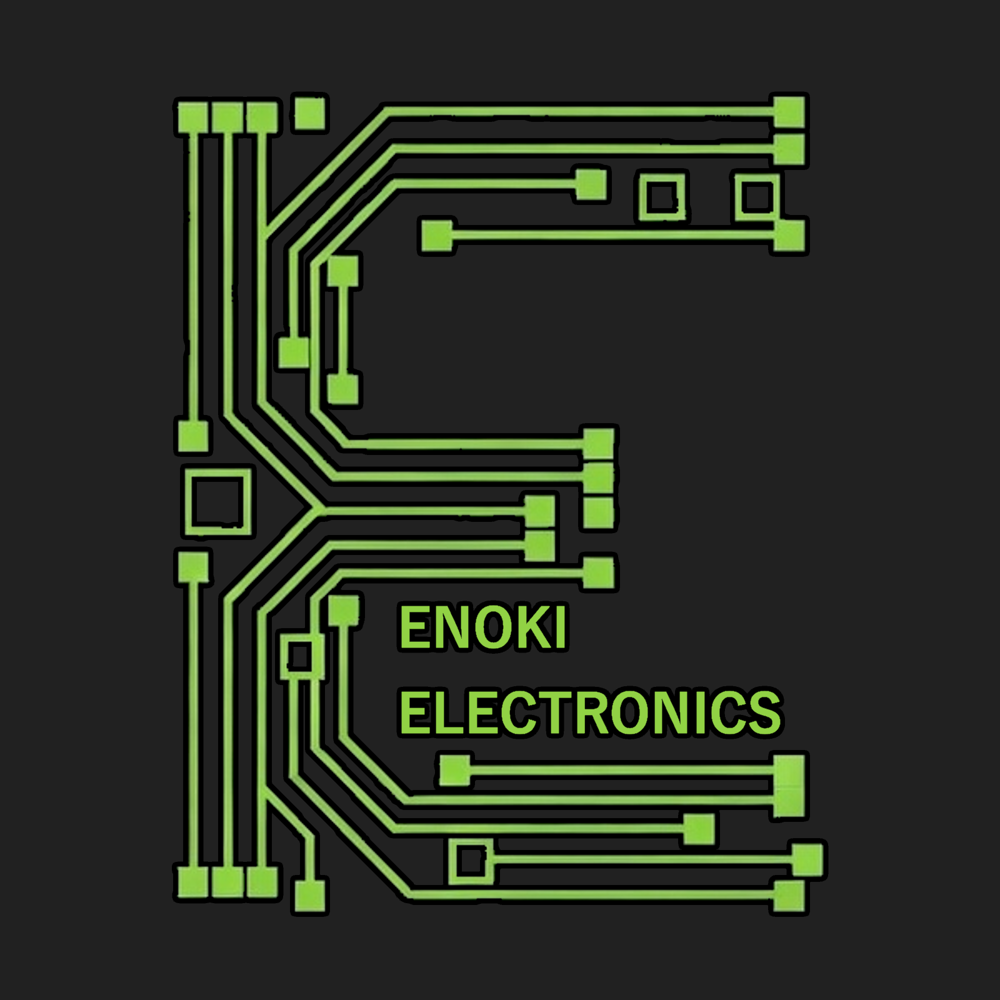

# Nuxt4-Capacitor-Template-2026

<p align="center">
  
</p>

<p align="center">
  <strong>Nuxt 4 + Capacitor 8 + PWA + Vuetify 3 + Custom CSS + PHP Backend</strong><br>
  Web（PWA）およびモバイルアプリ（iOS / Android）を単一のコードベースから高速開発できる、2026年最新仕様のプロダクション対応テンプレートリポジトリです。
</p>

<p align="center">
  
  
  
  
  
  
  
  
</p>

---

## 目次

1. [概要](#概要)
2. [主な機能・特徴](#主な機能特徴)
3. [技術スタック](#技術スタック)
4. [ページ・コンポーネント構成](#ページコンポーネント構成)
5. [ディレクトリ構成](#ディレクトリ構成)
6. [環境構築・クイックスタート](#環境構築クイックスタート)
   - [前提条件](#前提条件)
   - [1. 依存パッケージのインストール](#1-依存パッケージのインストール)
   - [2. 環境変数の設定 (.env)](#2-環境変数の設定-env)
   - [3. バックエンド設定 (env.php) & データベース初期化](#3-バックエンド設定-envphp--データベース初期化)
   - [4. 開発サーバーの起動](#4-開発サーバーの起動)
7. [モバイルアプリ開発 (Capacitor 8)](#モバイルアプリ開発-capacitor-8)
   - [Web アセットの生成とネイティブ同期](#web-アセットの生成とネイティブ同期)
   - [Android Studio での実行・デバッグ](#android-studio-での実行デバッグ)
   - [アイコン・スプラッシュ画像の自動生成](#アイコンスプラッシュ画像の自動生成)
8. [カスタマイズガイド](#カスタマイズガイド)
   - [アプリ名・パッケージIDの変更](#アプリ名パッケージidの変更)
   - [テーマカラー・フォントの調整](#テーマカラーフォントの調整)
9. [ライセンス](#ライセンス)

---

## 概要

**Nuxt4-Capacitor-Template-2026** は、次世代のマルチプラットフォームアプリケーション開発を最速で開始するために設計されたボイラープレートテンプレートです。

- **Web / PWA**: 最新の Nuxt 4 (app/ ディレクトリ構造) と Nitro エンジンによる高速 SSR / SSG、Service Worker によるオフライン対応
- **Mobile (iOS / Android)**: Capacitor 8 による高品質なハイブリッドアプリ化。ステータスバー連動、Android 15 Edge-to-Edge（切り欠き・ノッチ）対応
- **UI / デザイン**: Vuetify 3 (vuetify-nuxt-module) と統一フォント（Zen Maru Gothic）、SCSS レスポンシブミックスイン
- **バックエンド**: 軽量で即座に動作する PHP 8.2+ REST API と MySQL データベーススキーマ（ユーザー認証、セッション管理、プロフィール、WebPush通知、画像アップロード）

---

## 主な機能・特徴

- **Nuxt 4 互換アーキテクチャ**
  - `future.compatibilityVersion: 4` を有効化し、Nuxt 4 標準の `app/` ディレクトリ構造を採用
  - Pinia 永続化ストア (`pinia-plugin-persistedstate`) によるセッション・設定の保持
  - `@nuxtjs/i18n` による多言語化設定基盤
- **Capacitor 8 ネイティブ統合**
  - `@capacitor/core`, `@capacitor/android`, `@capacitor/status-bar`, `@capacitor/share`, `@capacitor/toast`, `@capacitor/camera`, `@capacitor/device` を標準搭載
  - Android 15 の Edge-to-Edge 仕様に対応したステータスバー・ナビゲーションバーのパディング自動調整
  - 開発者オプションによるステータスバーノッチの表示切り替えデバッグ機能
- **PWA (Progressive Web App) 対応**
  - Web App Manifest (`manifest.json`) と Service Worker (`sw.js`) によるブラウザ直接インストール対応
  - `@ionic/pwa-elements` によるネイティブ風UIポリフィル
  - Web Push 通知の受信・登録基盤
- **モダンデザイン & カスタムCSS**
  - Vuetify 3 マテリアルデザインコンポーネント & MDI アイコン (`@mdi/font`)
  - システム設定連動のライト / ダークテーマ自動切り替え & StatusBar 連動
  - 全体を丸ゴシック（Zen Maru Gothic）に統一
  - モバイル・タブレット・PWA を識別する SCSS メディアクエリミックスイン (`@mixin mq`)
- **洗練された標準 UI ページ**
  - **ようこそ画面 (トップ)**: 主要機能の紹介カードと各画面へのクイックリンク
  - **About ページ**: テンプレート概要、特徴、技術スタック、利用ガイド
  - **設定ページ**: 外観（テーマ/言語）、通知、利用規約、プライバシーポリシー、開発者オプション、ログイン
  - **ナビゲーションバー (BottomNav)**: 固定ボトムナビゲーションと「ようこそダイアログ」
  - **スプラッシュ画面 (commonSplash)**: アプリ起動時のスムーズな初期化表示
  - **QRコードスキャナー**: カメラを用いたQRコード読み取り画面
  - **利用規約 & プライバシーポリシー**: アプリ公開に必須の規約テンプレート
  - **サイバーパンク風 404 ページ**: ターミナル風自己診断コンソール付き 404 画面
- **PHP REST API & MySQL バックエンド**
  - API ID / Token / AccessKey によるセキュアな認証ヘッダー
  - トークンベースのユーザー認証、管理者登録、パスワード再設定
  - プロフィール管理 & 画像アップロード
  - Web Push トークン管理・配信スクリプト
  - `database.sql` によるワンクリック DB スキーマ作成

---

## 技術スタック

| 分類 | 技術 / ライブラリ | バージョン | 用途 |
| :--- | :--- | :--- | :--- |
| **Framework** | Nuxt | ^4.3.1 | フルスタック Web フレームワーク (Nuxt 4 モード) |
| **Core UI** | Vue.js | ^3.5.0 | リアクティブ UI ライブラリ |
| **Language** | TypeScript | ^5.x | 型安全な開発言語 |
| **UI Component** | Vuetify 3 | ^0.19.5 (Module) | マテリアルデザインコンポーネント |
| **Icons** | Material Design Icons | ^7.4.47 | MDI アイコンフォント |
| **Native Runtime** | Capacitor | ^8.1.0 | iOS / Android ネイティブアプリブリッジ |
| **State Store** | Pinia | ^3.0.4 | 状態管理 & 永続化 (`persistedstate`) |
| **Template Syntax**| Pug | ^3.0.3 | 簡潔な HTML テンプレート記法 |
| **Styling** | Sass (sass-embedded) | ^1.97.3 | SCSS カスタムスタイル |
| **Backend** | PHP | 8.2+ | 軽量 REST API サーバー |
| **Database** | MySQL / MariaDB | 5.7+ / 8.0+ | リレーショナルデータベース |

---

## ページ・コンポーネント構成

```
app/
├── app.vue                          # アプリケーションルート (共通レイアウト, テーマ連動, Android15ノッチ対応)
├── error.vue                        # エラーハンドリング
├── components/
│   ├── about/
│   │   └── AboutView.vue            # About コンポーネント (特徴, 技術スタック, ガイド)
│   └── common/
│       ├── BottomNav.vue            # ボトムナビゲーション & ようこそダイアログ
│       └── commonSplash.vue         # 起動時スプラッシュ画面
├── data/
│   └── profile.ts                   # テンプレート情報・技術スタック定義
├── js/
│   ├── ajaxFunctions.ts             # Ajax 通信ユーティリティ
│   ├── contentApi.ts                # PHP バックエンド通信クライアント
│   ├── Functions.ts                 # 共通ヘルパー関数
│   ├── indexedDb.ts                 # IndexedDB 永続化ヘルパー
│   ├── metaFunctions.ts             # メタタグ操作
│   ├── setup.ts                     # タイトル・OGP設定ヘルパー
│   └── webpush.ts                   # WebPush 登録・購読ヘルパー
├── mixins/
│   └── mixins.ts                    # Vue 共通 Mixin (Cookie操作, AjaxWithAuth等)
├── pages/
│   ├── index.vue                    # ホーム・ようこそ画面 (機能紹介 & クイックリンク)
│   ├── about.vue                    # About ページ (テンプレート情報)
│   ├── login.vue                    # ログイン画面
│   ├── registar.vue                 # 管理者アカウント作成画面
│   ├── password_reset.vue           # パスワード再設定画面
│   ├── privacy.vue                  # プライバシーポリシー
│   ├── terms.vue                    # 利用規約
│   ├── qrcode.vue                   # QRコードスキャナー画面
│   ├── [...slug].vue                # 404 Not Found (サイバーパンク風診断UI)
│   ├── profile/
│   │   └── index.vue                # ユーザープロフィール画面
│   ├── settings/
│   │   ├── index.vue                # 設定トップ画面
│   │   ├── display.vue              # 外観設定 (テーマ切り替え, 言語)
│   │   ├── developer-options.vue    # 開発者オプション (ノッチ切り欠き強制制御)
│   │   └── profile.vue              # プロフィール編集画面 (画像アップロード)
│   └── user/
│       └── [userId].vue             # 公開ユーザープロフィール画面
└── stores/
    ├── meta.ts                      # ページメタ情報ストア
    ├── myProfile.ts                 # ログインユーザープロファイルストア (永続化)
    ├── navigation.ts                # ナビゲーションダイアログ制御ストア
    └── settings.ts                  # アプリ設定ストア (テーマ, ノッチフラグ, 永続化)
```

---

## ディレクトリ構成

```
.
├── android/                         # Capacitor Android ネイティブプロジェクト
├── app/                             # Nuxt 4 フロントエンドソース
├── assets/                          # アイコン生成用元画像 (icon-only, icon-foreground, etc.)
├── icons/                           # 各解像度アプリアイコン
├── php/                             # PHP REST API バックエンド
│   ├── functions/                   # 認証・DB・メール・Push通知ユーティリティ
│   ├── public/                      # 静的公開ディレクトリ (uploads)
│   ├── createTable.php              # テーブル作成スクリプト
│   ├── authAccount.php              # アカウント認証 API
│   ├── loginAccount.php             # ログイン API
│   ├── logoutAccount.php            # ログアウト API
│   ├── updateProfile.php            # プロフィール更新 API
│   ├── uploadImage.php              # 画像アップロード API
│   └── ...                          # プッシュ通知、パスワード再設定等の API
├── public/                          # 静的公開ファイル (manifest.json, sw.js, style.css)
├── server/                          # Nitro サーバーエンジンルート & API
│   ├── api/
│   │   └── upload-image.post.ts     # ローカル画像アップロード API
│   ├── routes/
│   │   ├── sitemap.xml.ts           # 動的サイトマップ生成
│   │   └── rssfeed.xml.ts           # RSS 2.0 フィード生成
│   └── utils/
│       └── siteData.ts              # サイト共通ユーティリティ
├── capacitor.config.ts              # Capacitor 設定ファイル
├── database.sql                     # MySQL 初期化用 SQL スキーマ
├── env.example.php                  # PHP バックエンド用環境変数テンプレート
├── .env.example                     # フロントエンド用環境変数テンプレート
├── nuxt.config.ts                   # Nuxt 設定ファイル
└── package.json                     # プロジェクト定義 & スクリプト
```

---

## 環境構築・クイックスタート

### 前提条件

- **Node.js**: `v20.x` または `v22.x` 以上推奨
- **npm** / **yarn** / **pnpm**
- **PHP**: `8.1` または `8.2+`（PHPバックエンドを使用する場合）
- **MySQL**: `5.7+` または `8.0+`（PHPバックエンドを使用する場合）
- **Android Studio**: Android アプリをビルドする場合

### 1. 依存パッケージのインストール

```bash
npm install
```

### 2. フロントエンド環境変数の設定 (.env)

ルートディレクトリに `.env` を作成します（`.env.example` をコピー）：

```bash
cp .env.example .env
```

```ini
# WebPush 設定（https://web-push-codelab.glitch.me/ 等で生成可能）
NUXT_WEBPUSH_PUBLICKEY=
NUXT_WEBPUSH_PRIVATEKEY=

# API 接続設定 (同一オリジンの場合は空欄でも自動解決されます)
NUXT_API_ID=default
NUXT_API_TOKEN=
NUXT_API_ACCESSKEY=
NUXT_API_HOST=
```

### 3. バックエンド設定 (env.php) & データベース初期化

1. `env.example.php` をコピーしてプロジェクトルートの上位ディレクトリ（または指定パス）に `env.php` を配置します：

```bash
cp env.example.php ../env.php
```

2. `MySQL_Host`, `MySQL_DBName`, `MySQL_User`, `MySQL_Password`, `Admin_Register_Key` を環境に合わせて設定します。
3. MySQL に `database.sql` をインポートして初期テーブルを作成します：

```bash
mysql -u <ユーザー名> -p <データベース名> < database.sql
```

### 4. 開発サーバーの起動

```bash
npm run dev
```

ブラウザで `http://localhost:10000` を開きます。

---

## モバイルアプリ開発 (Capacitor 8)

本テンプレートは、Web 画面をそのまま iOS / Android ネイティブアプリとしてパッケージングできます。

### Web アセットの生成とネイティブ同期

```bash
# 1. 静的 HTML/JS アセットを生成 (dist/ に出力)
npm run generate

# 2. 生成アセットを Capacitor ネイティブプロジェクトへ同期
npx cap sync
```

※ または一括コマンド：
```bash
npm run cap:sync
```

### Android Studio での実行・デバッグ

```bash
npm run cap:open:android
```

Android Studio が起動したら、エミュレータまたは実機端末を選択して `Run (Shift + F10)` を実行します。

### アイコン・スプラッシュ画像の自動生成

`assets/` ディレクトリに元画像を配置し、以下のコマンドを実行すると各解像度のアプリアイコンとスプラッシュ画面が自動生成されます：

```bash
npx @capacitor/assets generate
```

---

## カスタマイズガイド

### アプリ名・パッケージIDの変更

新しいアプリを作成する際は、以下のファイルを検索・置換します：

1. **`capacitor.config.ts`**:
   - `appId`: `'com.yourcompany.yourapp'`
   - `appName`: `'Your App Name'`
2. **`package.json`**:
   - `name`: `'your-app-name'`
3. **`android/app/build.gradle`**:
   - `namespace = "com.yourcompany.yourapp"`
   - `applicationId "com.yourcompany.yourapp"`
4. **`android/app/src/main/res/values/strings.xml`**:
   - `app_name`, `title_activity_main`, `package_name`
5. **`public/manifest.json`**:
   - `name`, `short_name`, `description`
6. **`nuxt.config.ts`**:
   - `app.head.title`, `app.head.meta`

### テーマカラー・フォントの調整

- **テーマカラー**: `app/app.vue` の `:root` および `.v-theme--light`, `.v-theme--dark` で `--v-theme-primary` の RGB 値を変更できます。
- **フォント**: `nuxt.config.ts` の Google Fonts リンクおよび `app/app.vue` の `* { font-family: ... }` でお好みのフォントに変更可能です。

---

## ライセンス

MIT License
